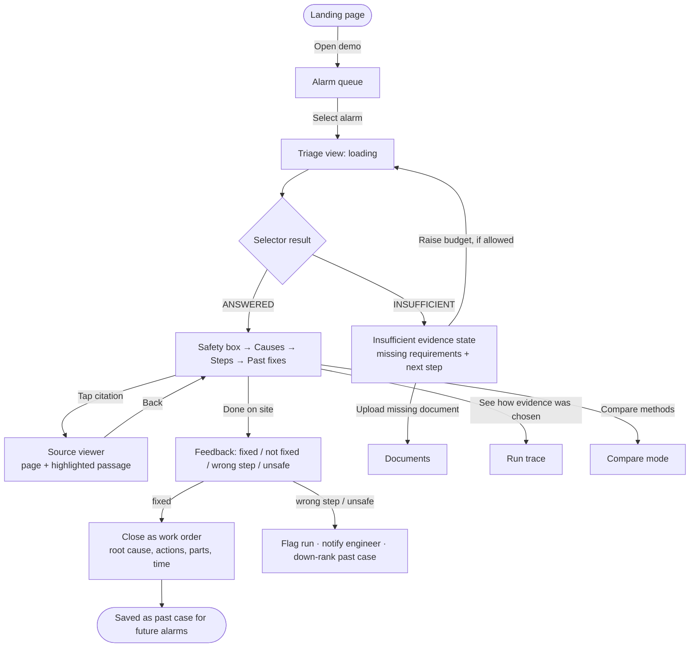
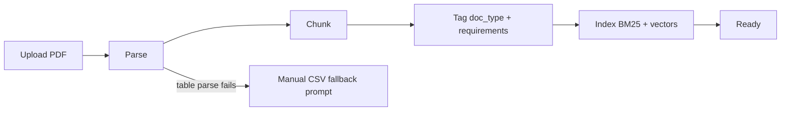
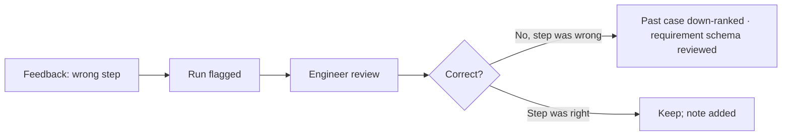

# SuryaSutra — App Flow

> Version 1.0 · 2026-10-28 · Screens, routes and paths through the product. Visual spec: `docs/DESIGN_BRIEF.md`.

---

## 1. Routes

| Route | Screen | Who | Release |
|---|---|---|---|
| `/` | Landing page | Visitors, reviewers, investors | R1 |
| `/app/alarms` | Alarm queue | Engineer | R1 |
| `/app/alarms/:id` | Triage view | Engineer, technician | R1 |
| `/app/alarms/:id/source/:chunkId` | Source viewer (panel / sheet) | Engineer, technician | R1 |
| `/app/compare/:alarmId` | Compare mode | Reviewer, engineer | R1 |
| `/app/runs/:id` | Run trace (selection animation, tokens) | Reviewer | R1 |
| `/app/dashboard` | Cost & quality dashboard | Manager | R1 |
| `/app/documents` | Documents & ingestion status | Engineer/admin | R1 |
| `/login` | Sign in | All | Pilot |

## 2. Main flow — alarm to safe action

## 3. Screen-by-screen

### 3.1 Landing page (`/`)
1. **Hero** — headline, one-line value, primary CTA "Try the demo", secondary "How it works". Animated alarm → bridge → checklist illustration.
2. **The problem** — three cards (alarm volume, knowledge in PDFs, safety can't be skipped).
3. **How it works** — 7-step pipeline, revealed on scroll.
4. **The safety guarantee** — token-budget animation: mandatory evidence locks in first, optional fills the rest.
5. **Built for the plant** — past fixes, citations, cost per alarm.
6. **Results** — pulled from `eval/results/summary.md`; shows "Not yet measured" until runs exist.
7. **Footer** — GitHub, paper (when available), contact.

### 3.2 Alarm queue (`/app/alarms`)
- Table (desktop) / card list (mobile): time, site, inverter, code, message, status chip.
- Filters: site, status (new / in progress / answered / insufficient / closed), synthetic toggle.
- Row click → triage view. New alarms slide in at the top.
- Empty state: "No open alarms" + link to load synthetic demo data.

### 3.3 Triage view (`/app/alarms/:id`)
Order on screen is fixed and safety-first:
1. Alarm header (code, inverter, site, time, synthetic badge).
2. **Safety box** (always first, never collapsible).
3. Likely causes with confidence labels (text, not colour alone).
4. Numbered steps with expected result and citation chips.
5. Similar past fixes (collapsible, stale/failed flags).
6. Escalate-if and uncertainties.
7. Usage footer: tokens in/out, ₹, latency, method, budget, model.
8. Actions: Mark outcome · Compare methods · View run trace.

States: loading (skeleton matching final layout) · answered · insufficient · error (retry) · offline (cached last answer, clearly marked).

### 3.4 Insufficient evidence state
- Title "Not enough evidence for a safe answer".
- Reason: `no_evidence` ("No document covers: DC isolation for this model") or `over_budget` ("Needs ~1,640 tokens; budget is 1,000").
- Missing requirements list.
- Next actions: upload a document · retry with a higher budget (if the user's role allows) · escalate to engineer.

### 3.5 Source viewer
- Desktop: right side panel (40% width). Mobile: bottom sheet, drag to expand.
- Document title, version, page number, highlighted passage, "Open full page".

### 3.6 Compare mode (`/app/compare/:alarmId`)
- Two columns (desktop) / swipeable tabs (mobile): Method A vs Method B, same alarm, same budget.
- Requirement checklist per column: covered ✓ / missing ✕ with text labels.
- Token budget bars animate from each run's real trace.
- Diff summary: "Top-k missed: DC isolation step" — only if the trace shows it.

### 3.7 Run trace (`/app/runs/:id`)
- Candidate list with tokens, relevance, requirements covered, decision and reason.
- Replayable "evidence packing" animation of the selection order.
- Config: method, budget, model, embedding model, git hash.

### 3.8 Dashboard (`/app/dashboard`)
- KPI tiles: runs, mean ₹/alarm, mandatory-coverage rate, abstention rate (logged data only).
- Charts: ₹ per alarm by method and budget; abstentions over time.
- Empty state when there are no runs: "No runs yet — run the eval or triage an alarm."

### 3.9 Documents (`/app/documents`)
- Upload (drag and drop), metadata form (brand, model, doc type, version).
- Ingestion progress: uploaded → parsed → chunked → tagged → indexed.
- Per-document chunk count and tagging coverage.

## 4. Secondary flows

## 5. Navigation

- Desktop: left sidebar (Alarms, Dashboard, Documents), top bar with method/budget controls (demo mode only).
- Mobile: bottom tab bar (Alarms, Dashboard, Documents); triage opens full-screen with back gesture.
- Landing → app via "Try the demo"; app → landing via logo.
