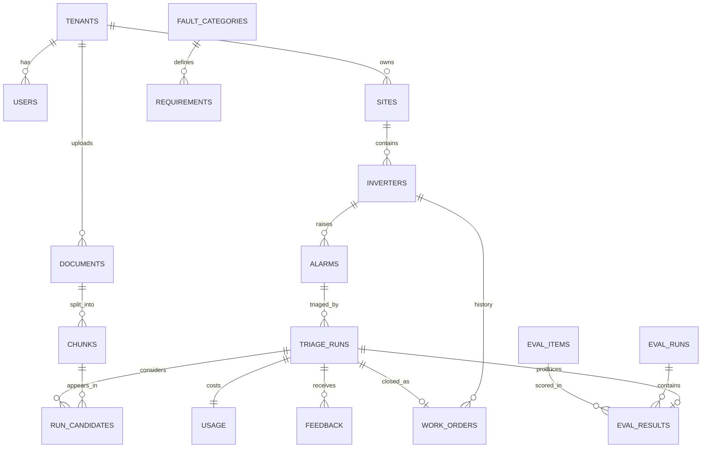

# SuryaSutra — Backend Schema

> Version 1.0 · 2026-10-28 · SQLAlchemy 2.0 models + Alembic migrations. SQLite (prototype) → Postgres 16 (pilot); avoid SQLite-only features.
> Tables marked **(pilot)** can be created empty in the prototype; `tenant_id` defaults to a single demo tenant until auth exists.

---

## 1. Entity-relationship diagram

## 2. Tables

Conventions: `id` = UUID (string in SQLite); timestamps UTC `timestamptz`; JSON columns = `JSON` (SQLite) / `JSONB` (Postgres); enums stored as strings with CHECK constraints.

### 2.1 Tenancy & assets

**tenants** (pilot)
| Column | Type | Notes |
|---|---|---|
| id | uuid PK | |
| name | text | |
| created_at | timestamptz | |

**users** (pilot)
| Column | Type | Notes |
|---|---|---|
| id | uuid PK | |
| tenant_id | uuid FK → tenants | |
| name | text | |
| email | text unique | |
| password_hash | text | argon2 |
| role | enum `technician, engineer, manager, admin` | |
| created_at | timestamptz | |

**sites**
| Column | Type | Notes |
|---|---|---|
| id | uuid PK | |
| tenant_id | uuid FK | |
| name | text | |
| state | text | e.g., Tamil Nadu |
| capacity_mw | numeric | |
| is_synthetic | bool | |

**inverters**
| Column | Type | Notes |
|---|---|---|
| id | uuid PK | |
| site_id | uuid FK → sites | |
| tag | text | e.g., INV-07 |
| brand | text | |
| model | text | |
| firmware_version | text null | |
| serial | text null | |
| is_synthetic | bool | |

### 2.2 Knowledge

**documents**
| Column | Type | Notes |
|---|---|---|
| id | uuid PK | |
| tenant_id | uuid FK | null = shared/public document |
| title | text | |
| brand, model | text null | filters |
| doc_type | enum `manual, fault_table, sop, safety, guide` | |
| version | text | |
| source_url | text null | |
| sha256 | text | integrity + reproducibility |
| license_note | text | never redistribute vendor PDFs |
| ingest_status | enum `queued, parsed, chunked, tagged, indexed, failed` | |
| ingest_error | text null | |
| ingested_at | timestamptz null | |

**chunks**
| Column | Type | Notes |
|---|---|---|
| id | uuid PK | |
| document_id | uuid FK → documents | |
| page_start, page_end | int | |
| section_path | text | e.g., "7 Troubleshooting > 7.3 Insulation" |
| text | text | |
| tokens | int | planning estimate |
| doc_type | enum `fault_code, procedure, safety, spec, past_case, other` | |
| covers | JSON array of requirement ids | from tagging rules |
| bbox | JSON null | highlight boxes for source viewer |
| embedding_ref | text | index id in FAISS/Qdrant |
| embedding_model | text | version |

**fault_categories**
| Column | Type | Notes |
|---|---|---|
| id | text PK | e.g., `insulation_fault` |
| description | text | |
| match_codes | JSON array | per brand |

**requirements**
| Column | Type | Notes |
|---|---|---|
| id | text PK | e.g., `safety_dc_isolation` |
| category_id | text FK → fault_categories | |
| description | text | |
| kind | enum `safety, cause, check, procedure, reset, escalation` | |
| mandatory | bool | |
| tag_rules | JSON | doc types + keywords |
| review_status | enum `unreviewed, reviewed, rejected` | expert gate |
| reviewed_by | text null | |

> `fault_categories` and `requirements` are loaded from `config/requirements.yaml` (the YAML is the source of truth; the table is a synced copy).

### 2.3 Operations

**alarms**
| Column | Type | Notes |
|---|---|---|
| id | uuid PK | |
| tenant_id | uuid FK | |
| site_id | uuid FK | |
| inverter_id | uuid FK | |
| code | text | vendor fault code |
| message | text | |
| category_id | text FK null | resolved fault category |
| raised_at | timestamptz | |
| status | enum `new, in_progress, answered, insufficient, closed` | |
| is_synthetic | bool | |

**triage_runs**
| Column | Type | Notes |
|---|---|---|
| id | uuid PK | |
| alarm_id | uuid FK → alarms | |
| user_id | uuid FK null | |
| method | enum `topk, mmr, knapsack, safety_slot, requirement_complete, ilp, closed_book` | |
| budget | int | tokens |
| include_past_cases | bool | |
| past_case_cap | numeric | share of budget, default 0.25 |
| status | enum `ANSWERED, INSUFFICIENT, ERROR` | |
| insufficient_reason | enum `no_evidence, over_budget, validation_failed` null | |
| missing_requirements | JSON array | |
| answer | JSON | answer contract (`CLAUDE.md` §10) |
| llm_provider, llm_model | text | |
| embedding_model | text | |
| git_commit | text | |
| seed | int | |
| created_at | timestamptz | |

**run_candidates** — the trace the UI animates
| Column | Type | Notes |
|---|---|---|
| run_id | uuid FK → triage_runs | PK part |
| chunk_id | uuid FK → chunks | PK part (or work_order_id for past cases) |
| work_order_id | uuid FK null | when candidate is a past case |
| retrieval_rank | int | |
| relevance | float | normalised hybrid score |
| tokens | int | |
| covers | JSON array | |
| decision | enum `selected_mandatory, selected_fill, selected_past_case, dropped_budget, dropped_duplicate, not_needed` | |
| selection_order | int null | order selected |

**usage**
| Column | Type | Notes |
|---|---|---|
| run_id | uuid PK, FK → triage_runs | |
| planned_input_tokens | int | estimate |
| input_tokens | int | provider-reported |
| output_tokens | int | provider-reported |
| token_source | enum `provider, estimate` | |
| cost_inr | numeric(10,4) | from `config/pricing.yaml` (dated) |
| latency_ms | int | end to end |
| retrieval_ms, selection_ms, generation_ms | int | |

**feedback**
| Column | Type | Notes |
|---|---|---|
| id | uuid PK | |
| run_id | uuid FK | |
| user_id | uuid FK null | |
| user_role | text | |
| outcome | enum `fixed, not_fixed, wrong_step, unsafe` | |
| step_n | int null | which step was wrong |
| note | text | |
| created_at | timestamptz | |

**work_orders**
| Column | Type | Notes |
|---|---|---|
| id | uuid PK | |
| tenant_id | uuid FK | |
| site_id | uuid FK | |
| inverter_id | uuid FK | |
| run_id | uuid FK null | if closed from a triage run |
| brand, model, firmware_version | text | |
| alarm_code | text | |
| symptoms | text | |
| root_cause | text | |
| actions | text | |
| parts_used | JSON array | |
| time_to_fix_min | int null | |
| outcome | enum `fixed, not_fixed, recurred` | |
| technician_notes | text | |
| closed_at | timestamptz | |
| is_synthetic | bool | |

### 2.4 Evaluation

**eval_items**
| Column | Type | Notes |
|---|---|---|
| id | text PK | stable item id |
| alarm_code, brand, model | text | |
| question | text | |
| answerable | bool | |
| gold_causes | JSON array | |
| gold_mandatory_chunks | JSON array | chunk ids |
| difficulty | enum `easy, medium, hard` | |
| category | text | fault-code, multi-cause, multi-source, conflicting, insufficient, safety, paraphrase |
| annotator_id | text | |
| adjudicated | bool | |

**eval_runs**
| Column | Type | Notes |
|---|---|---|
| id | uuid PK | |
| config | JSON | methods, budgets, models, seeds |
| git_commit | text | |
| started_at, finished_at | timestamptz | |

**eval_results**
| Column | Type | Notes |
|---|---|---|
| eval_run_id | uuid FK | PK part |
| eval_item_id | text FK | PK part |
| run_id | uuid FK → triage_runs | PK part |
| full_mandatory_coverage | bool | |
| cause_top3_correct | bool null | |
| citation_precision | float null | |
| abstained | bool | |
| scores | JSON | rubric details |

## 3. Indexes

| Table | Index |
|---|---|
| alarms | `(tenant_id, status, raised_at desc)`, `(inverter_id, raised_at desc)` |
| chunks | `(document_id)`, `(doc_type)` |
| triage_runs | `(alarm_id, created_at desc)`, `(method, budget)` |
| run_candidates | `(run_id, selection_order)` |
| work_orders | `(tenant_id, alarm_code)`, `(inverter_id, closed_at desc)`, `(model, alarm_code)` |
| feedback | `(run_id)` |
| eval_results | `(eval_run_id)` |

## 4. Integrity rules (enforced in code + tests)

1. A `triage_runs` row with `status = ANSWERED` must have every mandatory requirement of its category covered by a `run_candidates` row with `decision = selected_mandatory` whose source is a document chunk (not a work order).
2. Sum of `tokens` of selected candidates ≤ `budget`.
3. Sum of `tokens` of `selected_past_case` candidates ≤ `past_case_cap × budget`.
4. `usage.cost_inr` uses `token_source = provider` when available.
5. Pilot: every query filters by `tenant_id`; tests assert cross-tenant reads return nothing.
6. `is_synthetic` propagates: a run on a synthetic alarm is reported as synthetic.

## 5. Migrations

- Alembic, one migration per logical change, named `YYYYMMDD_<change>.py`.
- Seed script: `scripts/seed_demo.py` loads the demo tenant, synthetic sites/inverters/alarms/work orders, and syncs `requirements.yaml`.
