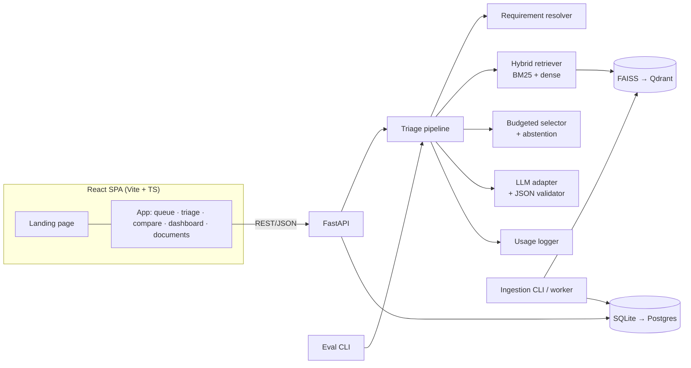

# SuryaSutra — Technical Requirements Document (TRD)

> Version 1.0 · 2026-10-28
> Source of truth for code rules: `CLAUDE.md`. Decisions and reasons: `docs/DECISIONS.md`. This TRD adds the web/animation stack and non-functional engineering requirements.

---

## 1. System overview

Modular monolith: one FastAPI service + one React SPA (app + landing page). Research modules (`ingest`, `retrieval`, `selection`, `eval`) are pure Python and never import app code.



## 2. Tech stack

### 2.1 Backend & research

| Layer | Choice | Version policy |
|---|---|---|
| Language | Python 3.11+ | pinned in `pyproject.toml` |
| API | FastAPI, Pydantic v2, Uvicorn | |
| ORM / migrations | SQLAlchemy 2.0, Alembic | |
| DB | SQLite (prototype) → Postgres 16 (pilot) | switch via `DATABASE_URL` |
| Vector index | FAISS flat IP → Qdrant | behind `VectorStore` interface |
| Lexical | `rank_bm25` | |
| Embeddings | `BAAI/bge-small-en-v1.5` | version stored per run |
| PDF | PyMuPDF, `pdfplumber` (tables) | CSV fallback for fault tables |
| LLM | Adapters: Anthropic, Gemini, Groq, Ollama | provider/model from `.env` |
| Tokens | Provider usage fields (truth), `tiktoken` (planning estimate) | |
| Optimisation | Greedy (stdlib), OR-Tools or PuLP (ILP) | |
| Tests | pytest, pytest-cov, Hypothesis | |

### 2.2 Frontend

| Concern | Choice | Why |
|---|---|---|
| Framework | React 18 + Vite + TypeScript (strict) | Founder knows React; fast builds |
| Styling | Tailwind CSS with design tokens from `DESIGN_BRIEF.md` as CSS variables | One source of colours/spacing; theming |
| Components | Radix UI primitives (dialog, tabs, tooltip, toggle) | Accessible by default; unstyled |
| Data fetching | TanStack Query | Caching, loading/error states |
| Routing | React Router | |
| Animation | **Motion** (`motion/react`, formerly Framer Motion) | Declarative React animations, layout transitions, gestures, `useReducedMotion` |
| Landing scroll effects | Motion `useScroll` / `whileInView` | No second animation library needed |
| Charts | Recharts | Simple, React-native |
| Icons | Lucide React | Consistent stroke icons |
| Fonts | Self-hosted via `@fontsource` (see design brief) | No external font requests; works offline |
| E2E | Playwright | 2–3 critical flows |

Not used (and why): GSAP (second animation system, licence/size not needed), Lottie (heavy JSON assets), Three.js (no 3D need), Lenis smooth-scroll (breaks native scroll and accessibility expectations).

## 3. Interfaces

### 3.1 REST API (prototype)

| Method | Path | Request | Response |
|---|---|---|---|
| GET | `/health` | — | `{status}` |
| GET | `/alarms` | `site, status, page` | paginated alarms |
| GET | `/alarms/{id}` | — | alarm detail |
| POST | `/triage` | `{alarm_id, method, budget, include_past_cases}` | Answer JSON or INSUFFICIENT (see `CLAUDE.md` §10) |
| GET | `/runs/{id}` | — | full trace: retrieved, selected (with reasons), dropped, tokens, answer |
| POST | `/compare` | `{alarm_id, methods[2], budget}` | two run ids + diff of selected requirements |
| GET | `/documents` | — | list with ingest status |
| POST | `/documents` | multipart PDF + metadata | `{document_id, status: queued}` |
| GET | `/documents/{id}/page/{n}` | `highlight=chunk_id` | page image/text + highlight boxes |
| GET | `/stats/usage` | `group_by, from, to` | aggregates from `usage` |
| POST | `/feedback` | `{run_id, outcome, note}` | `{ok}` |
| POST | `/runs/{id}/close` | `{root_cause, actions, parts, time_to_fix_min}` | `{work_order_id}` |

Errors: RFC 9457 problem JSON `{type, title, status, detail}`. `INSUFFICIENT` is a **200** with `status: "INSUFFICIENT"`, not an error.

### 3.2 Run trace (needed by the selection animation)

`GET /runs/{id}` must return, for each candidate chunk: `chunk_id, doc_type, tokens, relevance, covers[], decision` where `decision ∈ {selected_mandatory, selected_fill, selected_past_case, dropped_budget, dropped_duplicate, not_needed}` and `order` (selection sequence). The UI animates this trace; it never invents one.

## 4. Non-functional requirements

| Area | Requirement |
|---|---|
| Safety | Selector invariants enforced by property tests; answered run with uncovered mandatory requirement = test failure |
| Latency | API triage p95 ≤ 8 s (API model, target); retrieval + selection ≤ 300 ms for N=40 |
| Frontend performance | LCP ≤ 2.5 s, CLS ≤ 0.1, INP ≤ 200 ms on mid-range Android over 4G; JS bundle ≤ 250 KB gzip for app shell |
| Animation performance | Animate only `transform` and `opacity` (plus SVG `pathLength`); no layout thrash; 60 fps on mid-range Android |
| Accessibility | WCAG 2.2 AA; `prefers-reduced-motion` respected everywhere; focus visible; no information conveyed by motion or colour alone |
| Reliability | LLM call timeout 30 s, one retry; validator failure → one retry → INSUFFICIENT |
| Observability | Structured JSON logs with `run_id`; usage table is the cost source |
| Security | `.env` secrets; CORS locked to web origin; upload limit 50 MB, PDF only; tenant scoping in pilot |
| Reproducibility | Eval results JSON with config, versions, seed, git hash |

## 5. Testing strategy

| Level | What | Tool |
|---|---|---|
| Unit | token accounting, each selector, validator, requirement resolver | pytest |
| Property | selector never exceeds B; never answers with uncovered mandatory; deterministic | Hypothesis |
| Regression | fixed alarms whose safety chunks must always be selected | pytest |
| Integration | ingest → retrieve → select → generate (mock LLM) | pytest |
| API contract | response schemas | pytest + Pydantic |
| Frontend unit | components, reduced-motion behaviour | Vitest + Testing Library |
| E2E | open alarm → triage → open citation; compare mode; abstain state | Playwright |
| Accessibility | axe checks on key screens | `@axe-core/playwright` |

## 6. Deployment

- Local: `docker compose up` → `api` (Uvicorn), `web` (Vite build served by nginx), volumes for `data/`.
- Pilot: + `postgres`, `qdrant`; HTTPS via reverse proxy.
- CI (GitHub Actions): ruff, mypy, pytest, eval smoke test, web lint/typecheck/build, Playwright on preview.

## 7. Repository additions for the web app

```
web/
├── src/
│   ├── app/                 # routes: alarms, triage, compare, dashboard, documents
│   ├── landing/              # public landing page sections
│   ├── components/           # Button, Card, Badge, CitationChip, SafetyBox, TokenBudgetBar, ...
│   ├── motion/                # tokens.ts (durations/easings), variants.ts, useMotionPrefs.ts
│   ├── styles/                # tokens.css (CSS variables), tailwind.css
│   ├── api/                   # typed client, TanStack Query hooks
│   └── lib/
├── public/
└── tests/                     # vitest + playwright
```

## 8. Constraints & assumptions

- Prototype data is synthetic except public manuals and the NREL O&M guide.
- Vendor PDFs are never committed (D-13).
- English only in prototype (D-24).
- No numbers shown in the UI or landing page unless they come from logged runs.
